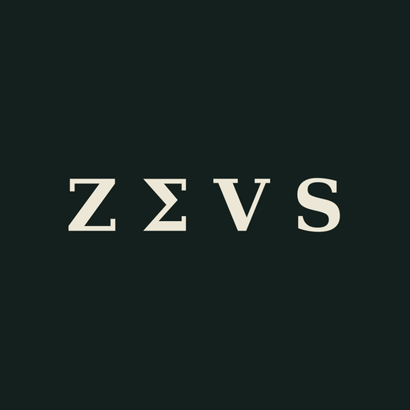

<p align="center">
  
</p>

<h1 align="center">ZΣVS lab</h1>

<p align="center">
  <b>Modern websites for businesses – design, development and support from a single source.</b><br>
  Web design studio based in Wiener Neustadt, Austria.
</p>

<p align="center">
  <a href="https://sax7lab.github.io/zeus-lab/"><b>Live site</b></a> ·
  <a href="https://sax7lab.github.io/zeus-lab/?lang=en">English version</a> ·
  <a href="https://www.linkedin.com/in/alexander-stelzer-3b62881a0/">LinkedIn</a>
</p>

---

## About

This repository holds the company website of **ZEUS lab**, a studio for web design and
web development founded by Alexander Stelzer, MA. The site is the studio's own showcase:
fast, accessible, mobile-first and built without templates or site builders.

## Features

- **Bilingual** – German by default, English via the DE | EN switch in the navigation.
  The choice is remembered, and `?lang=en` links straight to the English version.
- **Dark olive & beige design** – Geist typeface, glass navigation, bento-grid services,
  custom SVG icon set.
- **Interactive elements** – animated score rings, a tilting browser preview, and a
  load-time simulator based on Google/SOASTA bounce-rate research.
- **Packages** – Spark, Bolt, Olymp and Care, each preselecting the contact form.
- **Mobile-first** – tested down to 390 px, no horizontal scroll.
- **Accessible** – semantic markup, ARIA labels, keyboard navigation and
  `prefers-reduced-motion` support.
- **No build step** – a single `index.html` with inline CSS and JavaScript.

## Structure

```
index.html          the whole site: markup, styles, scripts
assets/
  zeus-icon-512.png logo / favicon / social preview
  apple-touch-icon.png
  portrait.jpg      founder photo
```

## Editing

**Company data** lives in the `CONFIG` object near the top of the script in `index.html`:
owner, phone, email, address, imprint details and package prices. A value left as `null`
shows up on the page as “folgt” / “to follow”, so nothing invented ever goes live.

**Translations** live in the `EN` dictionary right below it. Keys are the German texts as
they appear in the HTML. When you add or change German text, add the matching English
entry, or that text stays German in English mode.

## Running locally

Open `index.html` directly in a browser. No install or build is needed.

## Deployment

The site is served by **GitHub Pages** from the `main` branch. Every push goes live
within a minute or two.

## Roadmap

- [ ] Custom domain (`zeuslab.at`)
- [ ] Business email address
- [ ] Package prices and complete imprint details
- [ ] Privacy policy
- [ ] Contact form backend
- [ ] Self-hosted fonts (GDPR)

## License

© ZEUS lab · Alexander Stelzer. All rights reserved.
The code, design, texts and images may not be reused without permission.
